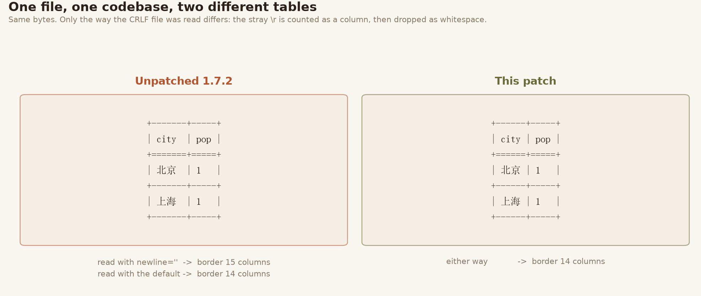
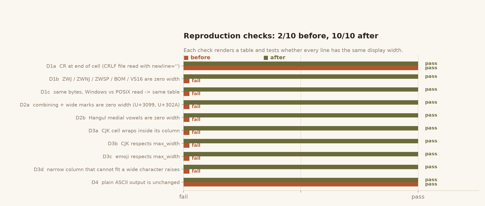
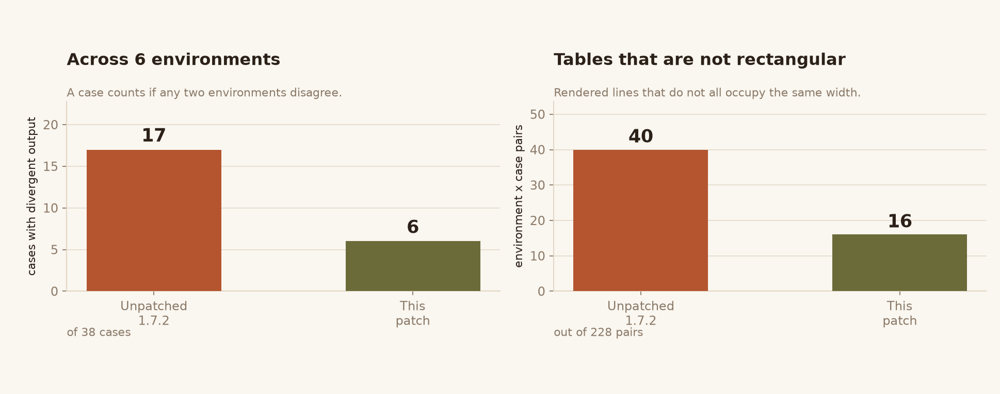
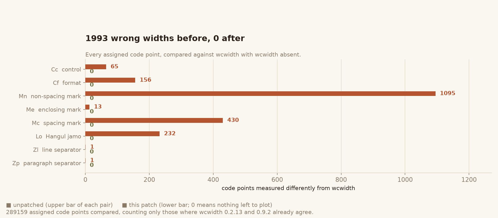
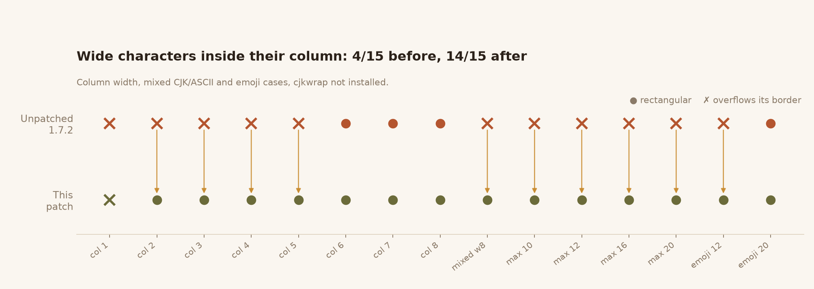
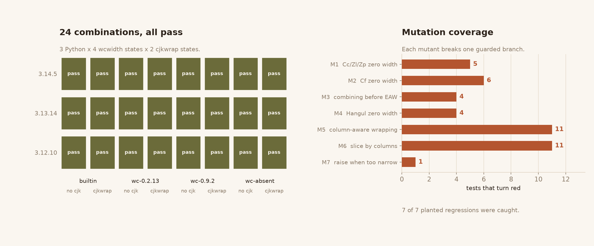

# texttable

Python module to create simple ASCII tables

> **This is a patched fork of [texttable 1.7.2](https://github.com/foutaise/texttable).**
> It fixes table layout that depended on the runtime environment rather than on
> the input: whether the optional `wcwidth` / `cjkwrap` packages happen to be
> installed, which Unicode version the interpreter ships, and whether the host
> reads text files with CRLF. See [FIXES.md](FIXES.md) for the analysis and
> [docs/assets](docs/assets) for the evidence. The upstream code and its MIT
> licence are unchanged otherwise.

## The defect in one picture

The same bytes, the same code, two different tables — because the file was read
two ways:



A stray `\r` left by `open(path, newline='')` is measured as one column, then
dropped by `textwrap` as whitespace, so the border ends up wider than its rows.

## What changed

Three independent defects, all of which only appear when the optional
dependencies are missing or when the data crosses a platform boundary:

| # | Defect | Effect |
|---|---|---|
| 1 | `Cc` / `Cf` / `Zl` / `Zp` counted as one column | zero-width characters widen the column |
| 2 | combining marks tested after East Asian width | `U+3099`-style marks counted as two columns |
| 3 | wrapping by character count, measuring by display column | wide characters overflow the border |



Across six environments (three Python versions x `wcwidth` present/absent x
`cjkwrap` present/absent) the number of cases that render differently drops,
and so does the number of tables that are not rectangular:



The fallback width function now agrees with `wcwidth` on every assigned code
point where `wcwidth` releases agree among themselves. Before the patch, 1 993
code points were measured differently:



Wide characters stay inside their column even when `cjkwrap` is not installed:



And the new tests have teeth — every deliberately planted regression is caught:



## Verifying it yourself

```bash
python reproduce.py                       # this directory: 10/10 checks pass
python reproduce.py --root ../texttable-1.7.2   # unpatched: 2/10
pytest tests.py test_crossenv.py -q       # 70 tests
```

The figures above are regenerated from `figs-data.json`, which records the
numbers produced by actually running both trees. Nothing in them is typed by
hand.

## Availability

This module is available on [PyPI](https://pypi.org/project/texttable/), and has been packaged for several Linux/Unix platforms
([Debian](https://packages.debian.org/search?&searchon=names&keywords=python-texttable+),
[FreeBSD](https://www.freebsd.org/cgi/ports.cgi?query=texttable&stype=all), Fedora, Suse...).

## Dependencies

If available, [cjkwrap](https://github.com/fgallaire/cjkwrap) library is used instead of textwrap, for a better wrapping of CJK text.

If available, [wcwidth](https://github.com/jquast/wcwidth) library is used for a better rendering (basic emoji support).

Neither is declared in `setup.py`, which is why the layout used to depend on the
installing environment. With this patch the fallback path produces the same
layout as the `wcwidth` path, so leaving them out is no longer a silent
behaviour change.

## Documentation

```
NAME
    texttable - module to create simple ASCII tables

FILE
    /usr/local/lib/python2.7/dist-packages/texttable.py

DESCRIPTION

    Example:

        table = Texttable()
        table.set_cols_align(["l", "r", "c"])
        table.set_cols_valign(["t", "m", "b"])
        table.add_rows([["Name", "Age", "Nickname"],
                        ["Mr\nXavier\nHuon", 32, "Xav'"],
                        ["Mr\nBaptiste\nClement", 1, "Baby"],
                        ["Mme\nLouise\nBourgeau", 28, "Lou\n\nLoue"]])
        print(table.draw())
        print()

        table = Texttable()
        table.set_deco(Texttable.HEADER)
        table.set_cols_dtype(['t',  # text
                              'f',  # float (decimal)
                              'e',  # float (exponent)
                              'i',  # integer
                              'a']) # automatic
        table.set_cols_align(["l", "r", "r", "r", "l"])
        table.add_rows([["text",    "float", "exp", "int", "auto"],
                        ["abcd",    "67",    654,   89,    128.001],
                        ["efghijk", 67.5434, .654,  89.6,  12800000000000000000000.00023],
                        ["lmn",     5e-78,   5e-78, 89.4,  .000000000000128],
                        ["opqrstu", .023,    5e+78, 92.,   12800000000000000000000]])
        print(table.draw())

    Result:

        +----------+-----+----------+
        |   Name   | Age | Nickname |
        +==========+=====+==========+
        | Mr       |     |          |
        | Xavier   |  32 |          |
        | Huon     |     |   Xav'   |
        +----------+-----+----------+
        | Mr       |     |          |
        | Baptiste |   1 |          |
        | Clement  |     |   Baby   |
        +----------+-----+----------+
        | Mme      |     |   Lou    |
        | Louise   |  28 |          |
        | Bourgeau |     |   Loue   |
        +----------+-----+----------+

         text     float       exp      int     auto
        ==============================================
        abcd      67.000   6.540e+02    89   128.001
        efghijk   67.543   6.540e-01    90   1.280e+22
        lmn        0.000   5.000e-78    89   0.000
        opqrstu    0.023   5.000e+78    92   1.280e+22

CLASSES
    class Texttable
     |  Methods defined here:
     |
     |  __init__(self, max_width=80)
     |      Constructor
     |
     |      - max_width is an integer, specifying the maximum width of the table
     |      - if set to 0, size is unlimited, therefore cells won't be wrapped
     |
     |  add_row(self, array)
     |      Add a row in the rows stack
     |
     |      - cells can contain newlines and tabs
     |
     |  add_rows(self, rows, header=True)
     |      Add several rows in the rows stack
     |
     |      - The 'rows' argument can be either an iterator returning arrays,
     |        or a by-dimensional array
     |      - 'header' specifies if the first row should be used as the header
     |        of the table
     |
     |  draw(self)
     |      Draw the table
     |
     |      - the table is returned as a whole string
     |
     |  header(self, array)
     |      Specify the header of the table
     |
     |  reset(self)
     |      Reset the instance
     |
     |      - reset rows and header
     |
     |  set_chars(self, array)
     |      Set the characters used to draw lines between rows and columns
     |
     |      - the array should contain 4 fields:
     |
     |          [horizontal, vertical, corner, header]
     |
     |      - default is set to:
     |
     |          ['-', '|', '+', '=']
     |
     |  set_cols_align(self, array)
     |      Set the desired columns alignment
     |
     |      - the elements of the array should be either "l", "c" or "r":
     |
     |          * "l": column flushed left
     |          * "c": column centered
     |          * "r": column flushed right
     |
     |  set_cols_dtype(self, array)
     |      Set the desired columns datatype for the cols.
     |
     |      - the elements of the array should be either a callable or any of
     |        "a", "t", "f", "e" or "i":
     |
     |          * "a": automatic (try to use the most appropriate datatype)
     |          * "t": treat as text
     |          * "f": treat as float in decimal format
     |          * "e": treat as float in exponential format
     |          * "i": treat as int
     |          * "b": treat as boolean
     |          * a callable: should return formatted string for any value given
     |
     |      - by default, automatic datatyping is used for each column
     |
     |  set_cols_valign(self, array)
     |      Set the desired columns vertical alignment
     |
     |      - the elements of the array should be either "t", "m" or "b":
     |
     |          * "t": column aligned on the top of the cell
     |          * "m": column aligned on the middle of the cell
     |          * "b": column aligned on the bottom of the cell
     |
     |  set_cols_width(self, array)
     |      Set the desired columns width
     |
     |      - the elements of the array should be integers, specifying the
     |        width of each column. For example:
     |
     |              [10, 20, 5]
     |
     |  set_deco(self, deco)
     |      Set the table decoration
     |
     |      - 'deco' can be a combination of:
     |
     |          Texttable.BORDER: Border around the table
     |          Texttable.HEADER: Horizontal line below the header
     |          Texttable.HLINES: Horizontal lines between rows
     |          Texttable.VLINES: Vertical lines between columns
     |
     |         All of them are enabled by default
     |
     |      - example:
     |
     |          Texttable.BORDER | Texttable.HEADER
     |
     |  set_header_align(self, array)
     |      Set the desired header alignment
     |
     |      - the elements of the array should be either "l", "c" or "r":
     |
     |          * "l": column flushed left
     |          * "c": column centered
     |          * "r": column flushed right
     |
     |  set_max_width(self, max_width)
     |      Set the maximum width of the table
     |
     |      - max_width is an integer, specifying the maximum width of the table
     |      - if set to 0, size is unlimited, therefore cells won't be wrapped
     |
     |  set_precision(self, width)
     |      Set the desired precision for float/exponential formats
     |
     |      - width must be an integer >= 0
     |
     |      - default value is set to 3
     |
     |  ----------------------------------------------------------------------
     |  Data and other attributes defined here:
     |
     |  BORDER = 1
     |
     |  HEADER = 2
     |
     |  HLINES = 4
     |
     |  VLINES = 8

DATA
    __all__ = ['Texttable', 'ArraySizeError']
    __author__ = 'Gerome Fournier <jef(at)foutaise.org>'
    __credits__ = 'Jeff Kowalczyk:\n    - textwrap improved import\n ...at...
    __license__ = 'MIT'
    __version__ = '1.7.2'

VERSION
    1.7.2

AUTHOR
    Gerome Fournier <jef(at)foutaise.org>

CREDITS
    Jeff Kowalczyk:
        - textwrap improved import
        - comment concerning header output

    Anonymous:
        - add_rows method, for adding rows in one go

    Sergey Simonenko:
        - redefined len() function to deal with non-ASCII characters

    Roger Lew:
        - columns datatype specifications

    Brian Peterson:
        - better handling of unicode errors

    Frank Sachsenheim:
        - add Python 2/3-compatibility

    Maximilian Hils:
        - fix minor bug for Python 3 compatibility

    frinkelpi:
        - preserve empty lines
```

## Forks

* [latextable](https://github.com/JAEarly/latextable) is a fork of texttable that provide a LaTeX backend.
